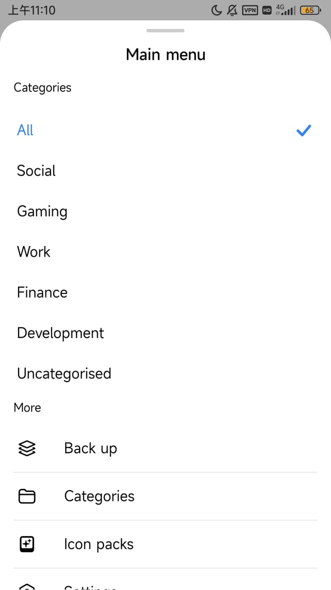
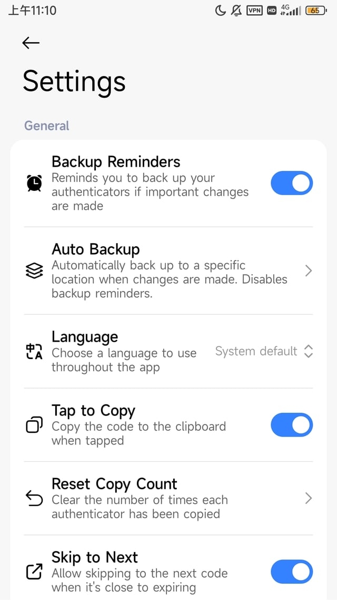
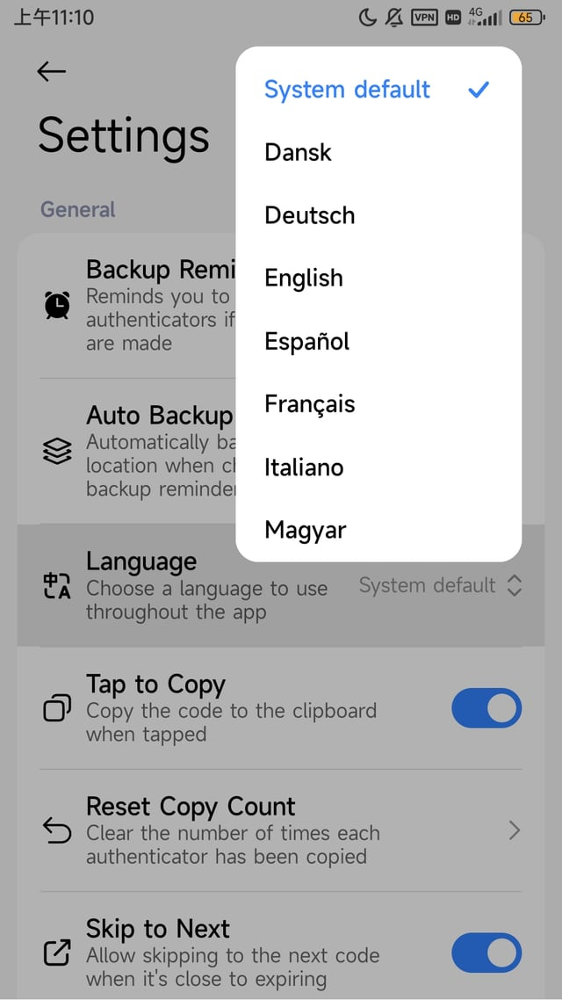
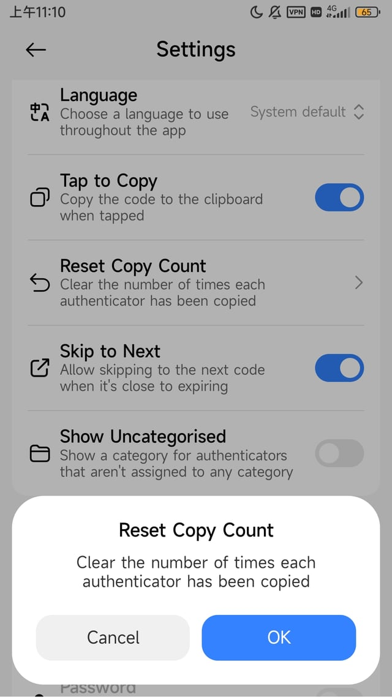
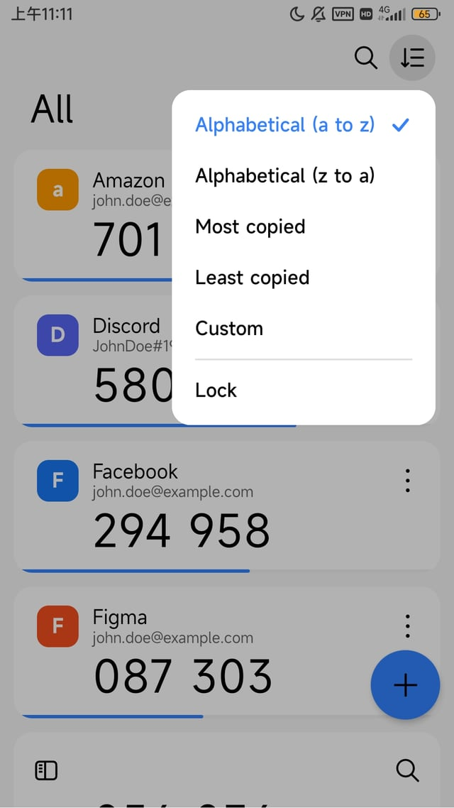

# miuix-agent-skill

给 AI 编程 agent 用的 **Miuix** 界面构建技能包：让 agent 按统一规范产出 Miuix（小米 HyperOS · Compose Multiplatform）界面，而不是凭记忆瞎写 API。

## 效果

**DeepSeek Harness + DeepSeek v4.1 Flash（high 思考强度）** 配合本 skill 生成的界面，未做手工布局调整：

<table>
  <tr>
    <td></td>
    <td></td>
    <td></td>
  </tr>
  <tr>
    <td></td>
    <td></td>
    <td></td>
  </tr>
</table>

## 安装

通用（[vercel-labs/skills](https://github.com/vercel-labs/skills)，支持 Claude Code、Codex、Cursor、OpenCode 等 80+ agent）：

```bash
# 项目级
npx skills add cyf112233/miuix-agent-skill

# 全局级
npx skills add cyf112233/miuix-agent-skill -g
```

DeepSeek Harness 全局（该 CLI 的全局目录 DSH 不读，DSH 的全局根是 `~/.dsh/skills`）：

```bash
git clone https://github.com/cyf112233/miuix-agent-skill.git ~/.dsh/skills/miuix-ui
```

装好后直接提需求即可，例如「用 miuix 写一个带分组开关的设置页」。

## 内容

8 个通用场景——主框架/多 Tab、首页仪表盘、通用列表、信息展示、表单编辑、状态页、自适应（大屏/折叠屏/RTL）、引导与权限——加设置页，每个都给可抄的完整结构。另含组件签名与默认值、主题配色、`miuix-nav` 导航、图标、旧版 API 迁移表、反模式清单，以及一个零依赖 lint：

```bash
node scripts/miuix-lint.mjs <你的项目目录>
```

规则标注了来源强度（库默认值 / 多数派惯例 / 单项目偏好 / 已被证伪），**单项目偏好不当规范**。

## 边界

组件、参数、枚举与声称的默认值都经机器校验；**能否编译、观感是否到位，需要你在真实工程里验证**。

## 许可

[Apache-2.0](LICENSE)，署名见 [NOTICE](NOTICE)；再分发需保留这两份并声明修改。

约定来自 Miuix 官方 example 与文档，以及 [InstallerX-Revived](https://github.com/wxxsfxyzm/InstallerX-Revived)、[lyricon](https://github.com/proify/lyricon)、[Updater-KMP](https://github.com/YuKongA/Updater-KMP)、[HyperStar](https://github.com/YunZiA/HyperStar)、[XiaomiHelper](https://github.com/HowieHChen/XiaomiHelper)、[OShin](https://github.com/suqi8/OShin)、[StatusBarLyric](https://github.com/Block-Network/StatusBarLyric)、[Payload-Dumper-Compose](https://github.com/rcmiku/Payload-Dumper-Compose) 的公开源码；与这些项目及小米公司无隶属关系。
